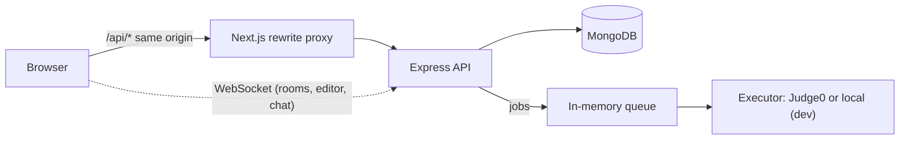

# ZCoder

ZCoder is a collaborative coding platform. You create a room, invite people with a code, edit the same file together in real time, chat, and run code on the server with the output shared to the whole room.

- **Frontend:** Next.js 16 (App Router) and Tailwind.
- **Backend:** Node.js (Express 5), MongoDB (Mongoose 8), Socket.IO and Yjs.

> **Status:** v2 is being rebuilt from scratch.
> - **Done:** accounts and authentication, the data model with indexes, rooms with presence and live chat, the shared editor (Yjs + Monaco, live cursors), and server-side code execution with a shared console (C++17, Python 3, JavaScript).
> - **In progress:** the Q&A board, deployment and benchmarks.
> - **Deferred until Docker is allowed:** the Docker sandbox executor and the Redis/BullMQ queue.

## Architecture



- The browser only talks to the Next.js origin, which proxies `/api/*` to the API. That keeps the refresh-token cookie first-party.
- Auth combines two tokens:
  - A 15-minute HS256 access JWT, verified without any database call.
  - An opaque refresh token in an httpOnly cookie, with rotation and reuse detection.

  Passwords use bcrypt (cost 12).
- Every hot query has a matching index, and the tests check that each one exists and is used.

## Run it locally (Windows, no Docker needed)

You need **Node.js 22 or newer**. Use three terminals (PowerShell or Git Bash).

> Keep the repo **outside OneDrive** or any other synced folder. `node_modules` holds tens of thousands of files, which a sync client will try to upload and lock.

```bash
# 1) Local MongoDB (downloads a mongod binary once, then keeps data in backend/.data)
cd backend
npm install
npm run db
```

```bash
# 2) API on http://localhost:4000
cd backend
cp .env.example .env        # then set JWT_ACCESS_SECRET (see below)
npm run dev
```

```bash
# 3) Web app on http://localhost:3000
cd frontend-next
npm install
npm run dev
```

To generate a secret for `JWT_ACCESS_SECRET`:

```bash
node -e "console.log(require('crypto').randomBytes(48).toString('base64url'))"
```

The API **refuses to start** if a required variable is missing or invalid, and it tells you which one.

**Running code locally.** By default `EXECUTOR=local`, which runs submitted code as child processes on your machine. It has timeouts and output caps but **no sandbox**, so use it only for your own testing. It needs `g++` (C++) and Python on your `PATH`; JavaScript uses the same Node.js as the API. The server refuses `EXECUTOR=local` when `NODE_ENV=production`. To use Judge0 instead, set `EXECUTOR=judge0` plus your own `JUDGE0_RAPIDAPI_KEY`, or a self-hosted `JUDGE0_URL`.

## Environment variables

**Backend** (`backend/.env`; every variable is documented in [backend/.env.example](backend/.env.example)):

| Variable | Required | Default | Purpose |
|---|---|---|---|
| `MONGODB_URI` | yes | — | `mongodb://127.0.0.1:27017/zcoder` locally, or your own Atlas URI |
| `JWT_ACCESS_SECRET` | yes | — | 32+ characters; signs access tokens |
| `PORT` | | 4000 | |
| `ACCESS_TOKEN_TTL_SECONDS` | | 900 | Access JWT lifetime |
| `REFRESH_TOKEN_TTL_DAYS` | | 14 | Refresh token lifetime |
| `BCRYPT_COST` | | 12 | |
| `CORS_ORIGINS` | | `http://localhost:3000` | Comma-separated |
| `TRUST_PROXY` | | 0 | Proxy hops in front of the API |
| `AUTH_RATE_LIMIT_PER_IP`, `LOGIN_FAILURES_PER_EMAIL` | | 50, 5 | Per 15 minutes |
| `ROOM_JOIN_FAILURES_PER_USER` | | 10 | Wrong room password or unknown code, per 15 minutes |
| `CHAT_MESSAGES_PER_10S` | | 20 | Chat messages per user per 10 seconds |
| `YJS_PERSIST_DEBOUNCE_MS` | | 2000 | Save a room's document this long after the last edit |
| `EXECUTOR` | | `local` | `local` (dev only, no sandbox; refused in production) or `judge0` |
| `JUDGE0_URL` | | RapidAPI's Judge0 CE | Your self-hosted Judge0, or the RapidAPI host |
| `JUDGE0_RAPIDAPI_KEY` | with a RapidAPI URL | — | Your own key; sent from the server only |
| `JUDGE0_AUTH_TOKEN` | | — | For a self-hosted Judge0 with auth enabled |
| `EXECUTION_CONCURRENCY`, `EXECUTION_QUEUE_MAX` | | 2, 50 | Runs at once; runs allowed to wait (beyond that: 503) |
| `EXECUTIONS_PER_MINUTE` | | 10 | Per user |
| `RUN_TIMEOUT_MS`, `COMPILE_TIMEOUT_MS`, `RUN_MEMORY_MB` | | 3000, 20000, 256 | Limits per run (memory is enforced by Judge0, not by the local executor) |

**Frontend** (`frontend-next/.env.local`, optional):

| Variable | Default | Purpose |
|---|---|---|
| `API_ORIGIN` | `http://localhost:4000` | Where `/api/*` is proxied (server-side only) |
| `NEXT_PUBLIC_SOCKET_URL` | `http://localhost:4000` | Socket.IO endpoint (the socket connects directly; Vercel can't proxy WebSockets) |

## Tests and lint

```bash
cd backend && npm test && npm run lint
cd frontend-next && npm test && npm run lint && npm run build
```

Backend tests run against a real MongoDB through mongodb-memory-server, with no Docker.
