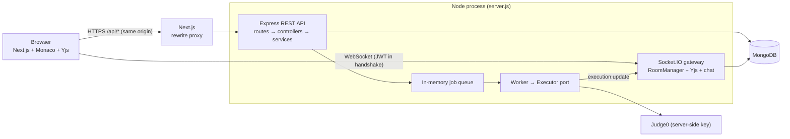

# ZCoder

ZCoder is a collaborative coding platform. You create a room and invite people with a code. Everyone edits the same file at the same time with live cursors, chats, and runs the code on the server, and the whole room sees each run's output.

- **Frontend:** Next.js 16 (App Router), React 19, Tailwind, Monaco.
- **Backend:** Node.js (Express 5), MongoDB (Mongoose 8), Socket.IO, Yjs.
- **Languages you can run:** C++17, Python 3, JavaScript (Node.js).

## Features

| Feature | How it works |
|---|---|
| Accounts | Short-lived stateless JWTs (verified without a DB call), rotating refresh tokens with reuse detection in an httpOnly cookie, bcrypt |
| Rooms | Invite codes, optional room password, owner/editor/viewer roles, up to 20 members, multi-tab presence |
| Shared editor | One Yjs CRDT document per room over the room's socket; Monaco with remote cursors; the language synced through the doc; saved to MongoDB |
| Live chat | Persist-then-broadcast, idempotent retries (`clientMsgId`), history with cursor pagination |
| Run code | `POST /api/executions` → bounded queue → executor (Judge0, or a dev-only local runner) → verdict → pushed to everyone in the room |
| Q&A board | Ask a problem, answer it, public feed |

## Architecture



- **REST goes through the Next.js rewrite**, so the refresh cookie is first-party. **The socket connects directly** (Vercel can't proxy WebSockets) and authenticates with the access token.
- **The room controller** (`backend/src/realtime/roomManager.js`) keeps one in-memory session per active room: who's online, their roles, and the room's Yjs document. It saves the document about 2 s after the last edit and when the room empties.
- **Ports and adapters:** the queue and the executor sit behind small interfaces. Today that's an in-memory queue, plus Judge0 or a dev-only local runner. A Docker executor and BullMQ/Redis are designed but deferred.

## Run it locally (Windows, no Docker needed)

You need **Node.js 22 or newer**. To run C++ and Python locally you also need `g++` and Python on your `PATH`. Use three terminals (PowerShell or Git Bash).

> Keep the repo **outside OneDrive** or any other synced folder. `node_modules` holds tens of thousands of files, which a sync client will try to upload and lock.

```bash
# 1) Local MongoDB (downloads a mongod binary once, then keeps data in backend/.data)
cd backend
npm install
npm run db
```

```bash
# 2) API on http://localhost:4000
cd backend
cp .env.example .env        # then set JWT_ACCESS_SECRET (see below)
npm run dev
```

```bash
# 3) Web app on http://localhost:3000
cd frontend-next
npm install
npm run dev
```

To generate a secret for `JWT_ACCESS_SECRET`:

```bash
node -e "console.log(require('crypto').randomBytes(48).toString('base64url'))"
```

The API **refuses to start** if a required variable is missing or invalid, and it tells you which one (never the value).

**Running code locally.** By default `EXECUTOR=local`, which runs submitted code as child processes on your machine. It has timeouts, output caps and an environment allowlist, but **no sandbox**, so use it only for your own testing. The server refuses `EXECUTOR=local` when `NODE_ENV=production`. To use Judge0 instead, set `EXECUTOR=judge0` plus your own `JUDGE0_RAPIDAPI_KEY`, or a self-hosted `JUDGE0_URL`.

## Environment variables

**Backend** (`backend/.env`; every variable is documented in [backend/.env.example](backend/.env.example)):

| Variable | Required | Default | Purpose |
|---|---|---|---|
| `MONGODB_URI` | yes | — | `mongodb://127.0.0.1:27017/zcoder` locally, or your own Atlas URI |
| `JWT_ACCESS_SECRET` | yes | — | 32+ characters; signs access tokens |
| `PORT` | | 4000 | |
| `ACCESS_TOKEN_TTL_SECONDS`, `REFRESH_TOKEN_TTL_DAYS` | | 900, 14 | Token lifetimes |
| `BCRYPT_COST` | | 12 | |
| `CORS_ORIGINS` | | `http://localhost:3000` | Comma-separated; the socket needs the web app's origin here |
| `TRUST_PROXY` | | 0 | Proxy hops in front of the API |
| `AUTH_RATE_LIMIT_PER_IP`, `LOGIN_FAILURES_PER_EMAIL` | | 50, 5 | Per 15 minutes |
| `ROOM_JOIN_FAILURES_PER_USER` | | 10 | Wrong room password or unknown code, per 15 minutes |
| `CHAT_MESSAGES_PER_10S` | | 20 | Per user, across tabs |
| `YJS_PERSIST_DEBOUNCE_MS` | | 2000 | Save a room's document this long after the last edit |
| `EXECUTOR` | | `local` | `local` (dev only, no sandbox; refused in production) or `judge0` |
| `JUDGE0_URL` | | RapidAPI's Judge0 CE | Or your self-hosted Judge0 |
| `JUDGE0_RAPIDAPI_KEY` | with a RapidAPI URL | — | Your own key; sent from the server only |
| `JUDGE0_AUTH_TOKEN` | | — | For a self-hosted Judge0 with auth enabled |
| `EXECUTION_CONCURRENCY`, `EXECUTION_QUEUE_MAX` | | 2, 50 | Runs at once; runs allowed to wait (beyond that: 503) |
| `EXECUTIONS_PER_MINUTE` | | 10 | Per user |
| `RUN_TIMEOUT_MS`, `COMPILE_TIMEOUT_MS`, `RUN_MEMORY_MB` | | 3000, 20000, 256 | Per-run limits (memory is enforced by Judge0, not by the local runner) |

**Frontend** (`frontend-next/.env.local`, optional):

| Variable | Default | Purpose |
|---|---|---|
| `API_ORIGIN` | `http://localhost:4000` | Where `/api/*` is proxied (server-side only) |
| `NEXT_PUBLIC_SOCKET_URL` | `http://localhost:4000` | Socket.IO endpoint (the socket connects directly) |

## Tests, lint and CI

```bash
cd backend && npm test && npm run lint
cd frontend-next && npm test && npm run lint && npm run build
```

- **Backend:** 199 Jest tests against a real MongoDB (mongodb-memory-server, no Docker). They cover auth, rooms, sockets with real clients, Yjs convergence, execution against the real `g++`/`python`/`node` (each skipped if missing), and query plans.
- **Frontend:** unit tests for the Monaco ↔ Yjs binding use Node's built-in test runner.
- **CI:** [`.github/workflows/ci.yml`](.github/workflows/ci.yml) runs all of the above on every push to `main` and on every pull request, plus a scan for committed credentials.

## Benchmarks

All measured on one 2016 dual-core laptop over loopback. Each number comes from the script listed under the table.

| What | Result |
|---|---|
| "Last 50 messages" on 200,000 messages (B2) | 50 docs examined with the `{roomId, _id}` index vs ~25,000 without a `roomId` index; p50 2.3 ms vs 98 ms |
| Room session endpoint (B3) | p50 6.4 ms / p95 9.6 ms (one client at a time) |
| Chat broadcast, 50 sockets in a room (B4) | delivery p50 ≈ 7 ms, p95 ≤ 17 ms |
| bcrypt cost 12 (B1) | ≈ 0.4–0.8 s per hash, depending on CPU power state |

```bash
cd backend
npm run bench:index    # B2
npm run bench:session  # B3
npm run bench:chat     # B4
npm run bench:bcrypt   # B1
npm run bench:yjs      # B5 (Yjs document size)
```

## Deploying

The target is Vercel (web), Render (API) and your own MongoDB Atlas M0 cluster, with Judge0 for execution. [`render.yaml`](render.yaml) is a Render Blueprint for the API. On Vercel, set the project root to `frontend-next` and point `API_ORIGIN` and `NEXT_PUBLIC_SOCKET_URL` at the API. Before the first boot, build the indexes once with `npm run db:indexes`.

## Limitations

- **No Docker sandbox yet.** In production, code runs on Judge0. The local runner has no isolation and is dev-only. The Docker executor, BullMQ/Redis and docker-compose are deferred until Docker is allowed on the dev machine.
- **One API instance.** Presence, Yjs documents, rate-limit counters and the queue live in one process. The multi-node design (room affinity, Socket.IO Redis adapter) is designed, not built.
- **Not deployed yet.**
- **Web app:** no Content-Security-Policy yet (Monaco loads from a CDN).
